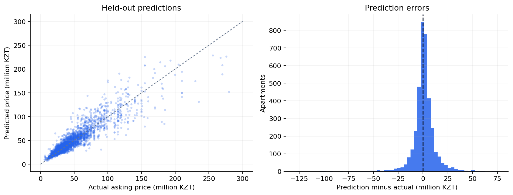

# EstatePulse

**A diploma project connecting apartment-price estimation with a full-stack web application.**

EstatePulse estimates **apartment asking prices in Astana** from nine property features. Users can calculate a price, register, and revisit their saved estimates. Administrators can publish real-estate articles in city-specific feeds.

**Stack:** React · Vite · Node.js / Express · MongoDB · FastAPI · pandas · scikit-learn

[Русская инструкция запуска](docs/RUNBOOK_RU.md) · [Data & model card](docs/DATA_CARD.md) · [Training notebook](ml/notebooks/01_train_model.ipynb) · [Recorded metrics](ml/reports/metrics.json)

## What is implemented

- Property valuation with district, year built, area, rooms, floor, total floors, ceiling height, building type and condition.
- Shared training/API category definitions, served to the form through model metadata.
- JWT authentication, reader/admin permissions and owner-only access to saved valuations.
- Guest predictions without storing inaccessible history records.
- Article creation, editing, deletion and city/category/title filters.
- Reproducible training, grouped validation, a median baseline, automated tests and CI.
- Docker Compose for the application, model training and database.

The valuation model supports **Astana only**. Article feeds also support Almaty and Shymkent. News monitoring, external economic signals and 1–3 year price forecasts are **future work**, not implemented features.

## Model results

Source snapshot: **January 3–6, 2026**. Original dataset: **18,388 rows**; retained after cleaning: **18,213**.

Apartments are grouped by residential complex, falling back to district + address. Groups do not cross the train, validation and test partitions. Model selection uses **validation MAE**, followed by refitting on train + validation and a single held-out test evaluation.

| Held-out test model | MAE, KZT | RMSE, KZT | R² |
| --- | ---: | ---: | ---: |
| Median baseline | 18,225,557 | 30,314,250 | -0.082 |
| Selected Extra Trees | **7,226,096** | **12,059,539** | **0.829** |

Test set: **3,732 apartments**. R² is not an accuracy percentage. These results are not directly comparable with the earlier random row split. They describe this historical dataset, not current market accuracy.



Error varies with price: test MAE is approximately **3.37m KZT below 30m**, and **27.31m KZT above 100m**. See [price-band diagnostics](ml/reports/error_by_price_band.csv). Predictions are estimates of listing prices, not completed transactions or professional appraisals.

## Quick start with Docker

Requires Docker Engine/Desktop with Compose. From the repository root:

```bash
git clone https://github.com/yrysmadiev1-cell/estatepulse-clean.git
cd estatepulse-clean
cp .env.example .env
```

Set a random `JWT_SECRET` in `.env` (at least 32 characters). Generate one with Node.js:

```bash
node -e "console.log(require('crypto').randomBytes(32).toString('hex'))"
```

Copy the generated value into `JWT_SECRET`. To enable first-run administrator creation, also set `ADMIN_EMAIL` and a strong `ADMIN_PASSWORD` (at least 12 characters, at most 72 UTF-8 bytes). Leave both blank to disable it; public registration always creates readers unless performed by an authenticated admin.

```bash
docker compose up --build
```

The training service creates the model before the ML/API services start. Initial dependency installation and training take a few minutes. Open **http://localhost:3000**. FastAPI documentation: **http://localhost:8000/docs**. The database is not published to the host network. These Compose defaults are for local use; internet hosting additionally needs HTTPS and deployment-specific configuration.

```bash
docker compose down                 # stop; preserve data and trained model
```

## Local development

Requires **Python 3.12**, **Node.js 22.12+** and a running **MongoDB 7**.

```bash
python -m venv .venv
source .venv/bin/activate            # Windows PowerShell: .venv\Scripts\Activate.ps1
pip install -r ml/requirements-dev.txt
python -m ml.train
cp backend/.env.example backend/.env
```

Fill `JWT_SECRET` in `backend/.env`; set `MONGO_URI` if your database uses a different location/name. Run these in **three terminals**, from the repository root:

```bash
# Terminal 1 — activate the Python environment first
python -m uvicorn ml.service.main:app --host 127.0.0.1 --port 8000
```

```bash
# Terminal 2
npm ci --prefix backend
npm start --prefix backend
```

```bash
# Terminal 3
npm ci --prefix frontend
npm start --prefix frontend
```

The web dev server proxies `/api` to port 5000. For separate frontend hosting, set `VITE_API_URL` before building and configure `CORS_ORIGINS` on the backend. For same-origin hosting, leave `VITE_API_URL` empty and proxy `/api`; the included Nginx config demonstrates this.

Model paths are resolved relative to the ML package, not the shell directory. `MODEL_PATH` can override the artifact path. Missing/incompatible artifacts produce an instruction to retrain. Only load model files you created or trust.

For the notebook, also install `ml/requirements-notebook.txt` and use the same Python environment as your Jupyter kernel. Training is implemented once in `ml/train.py`; the notebook calls it and explains the experiment.

## API overview

| Method | Endpoint | Purpose |
| --- | --- | --- |
| POST | `/api/register`, `/api/login` | Create an account / obtain a one-hour JWT |
| GET | `/api/evaluate/metadata` | Supported categories, ranges and model metadata |
| POST | `/api/evaluate` | Validate input, predict, save for authenticated users |
| GET | `/api/evaluations`, `/api/evaluations/:id` | Current user's saved results |
| GET | `/api/posts`, `/api/posts/:id` | Read articles |
| POST / PATCH / DELETE | `/api/posts` / `/api/posts/:id` | Admin article management |
| GET | `/health` | Backend database readiness |
| GET | ML `/health`, `/metadata` | Model readiness and contract |
| POST | ML `/predict` | Internal prediction endpoint |

Example request to `POST /api/evaluate`:

```json
{
  "city": "Астана",
  "district": "Есильский р-н",
  "area": 65,
  "rooms": 2,
  "floor": 5,
  "total_floors": 9,
  "ceiling_height": 2.7,
  "year_built": 2015,
  "house_type": "кирпичный",
  "condition": "свежий ремонт"
}
```

Authenticated requests use `Authorization: Bearer <token>`. Predictions return KZT price, price per m², normalized input, model version and a `saved` flag. Validation, unavailable-service and timeout failures use distinct HTTP statuses.

## Project layout

```text
backend/              Express API, authentication, MongoDB models and tests
frontend/             React/Vite interface and component tests
ml/schema.py          Supported features, categories and input validation
ml/train.py           Data preparation, grouped selection, evaluation and export
ml/service/           FastAPI inference service
ml/notebooks/         Executed explanatory notebook
ml/data/              Source dataset used for training
ml/reports/           Metrics, dataset hash and price-band diagnostics
ml/model/             Generated model artifacts (not tracked)
docs/                 Data card, migration and Russian setup instructions
compose.yaml          Local application stack
```

The web form calls Express, which calls FastAPI and stores authenticated results in MongoDB. FastAPI uses the exact pipeline selected and evaluated during training.

## Verification

```bash
python -m pytest -q
npm test --prefix frontend
npm run build --prefix frontend
npm test --prefix backend
```

Backend integration tests download MongoDB 7.0.24 on first use and run an isolated temporary database, plus an HTTP ML fixture. `npm run test:unit --prefix backend` runs only the route/security tests without MongoDB. Python tests cover validation, imputation, group isolation and the inference contract. CI also trains a fresh model and exercises it.

## Upgrading from v1

- Retrain the model; the old joblib file and old `house_age` request contract are incompatible. The new input is `year_built` plus `district` and an explicit Astana scope.
- Existing saved estimates remain readable, with v1 records labeled as archived.
- Article API paths moved from `/posts` to `/api/posts`; browser routes still use `/posts/...`.
- Replace `REACT_APP_API_URL` with `VITE_API_URL` and rebuild the frontend.
- Set a new random JWT secret. Old sessions will require login again.
- To reuse your previous database, set `MONGO_URI` to its original name (e.g. `blogdb`). No database migration or deletion is performed automatically.
- If an earlier deployment created the default administrator, reset/remove that account before reusing it. Changing environment variables alone does not update an existing account password.

## Limitations and provenance

This is a portfolio/diploma prototype using a historical listing snapshot. It has no out-of-time validation, verified transaction prices, calibrated prediction intervals or independent audit. Building groups and geographical filtering are heuristic. Dataset collection permissions and redistribution terms were not included in the original repository; see the [data card](docs/DATA_CARD.md).

**Author:** Ырысдаулет Мадиев · [GitHub](https://github.com/yrysmadiev1-cell)
